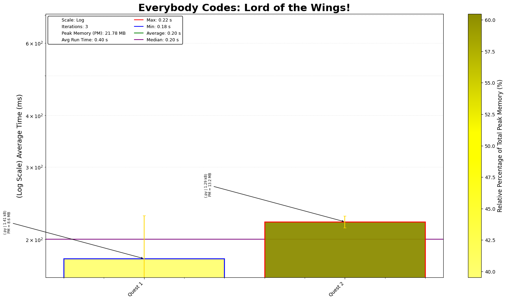

# Everybody Codes 2026 - Lord of the Wings

This repository contains coding solutions for the 2026 Everybody Codes. Each day's challenge offers unique puzzles requiring efficient coding, algorithmic thinking, and optimization.

## Day-by-Day Coding Overview

1. **Day 1 - The Conservation**: Simple exercise, took a while to debug it tho.
2. **Day 2 - The Axeperiment**: Well this was a different algorithm to learn