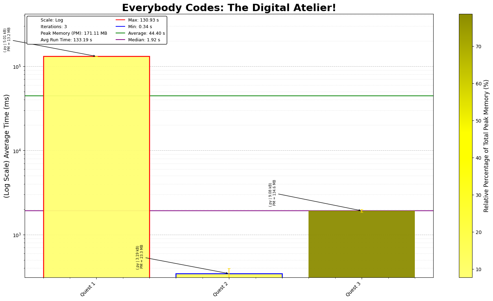

# Everybody Codes - The Digital Atelier

## Day-by-Day Coding Overview

1. **Quest 1 - The Recamán Drapery**: A fun challenge of figuring out sequences and nuber handling
2. **Quest 2 - Sir Sierpiński's Sparkballs**: Different approach to floodfill algortihm with an addition twist of randomness
3. **Quest 3 -**